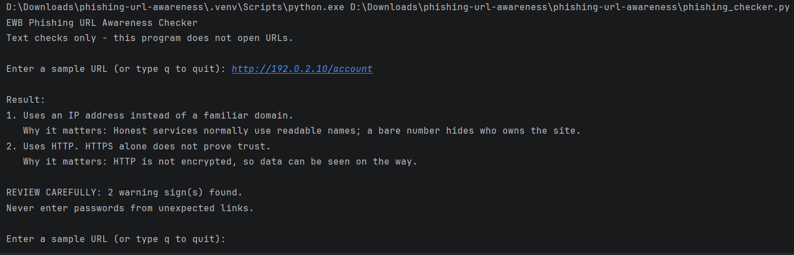
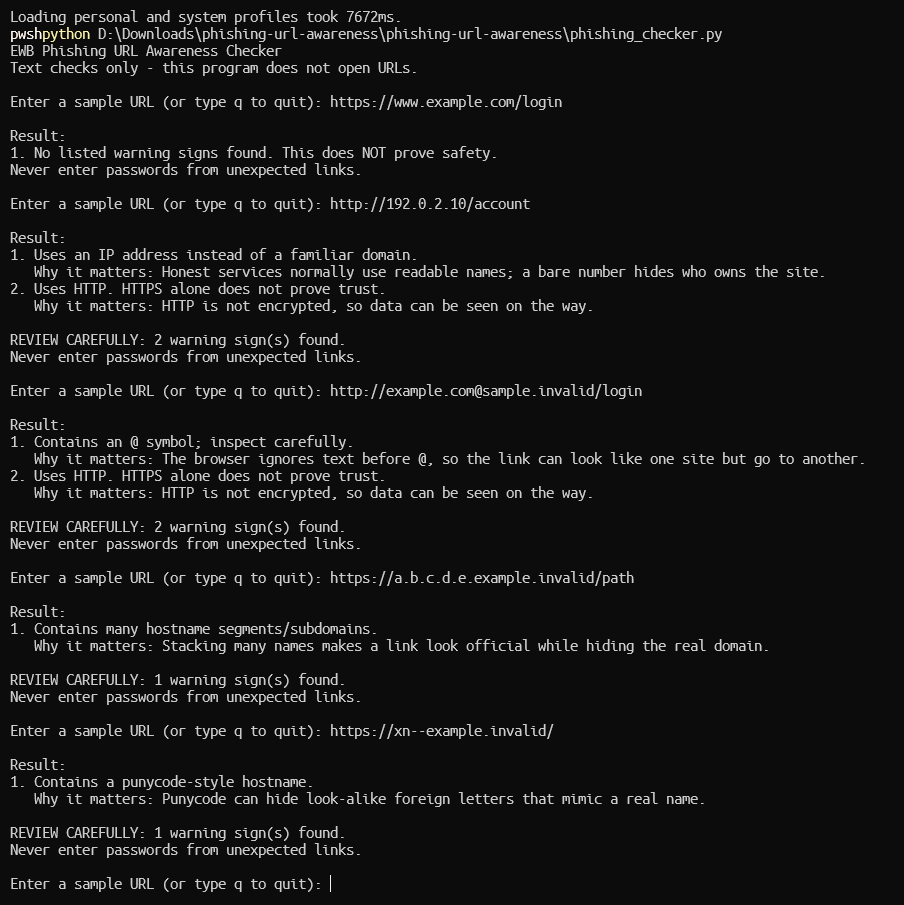

# EWB Phishing URL Awareness Checker

## Overview
Phishing is a trick where criminals use fake links or messages to steal passwords, card numbers or OTPs. This command-line tool reads a URL as plain text and points out a few visible warning signs. It never visits the link.

## Features
- Detects an @ symbol in the URL
- Flags unusually long URLs (over 100 characters)
- Flags IP-address hostnames
- Flags many hostname segments (5 or more)
- Flags punycode-style hostnames (xn--)
- Flags the HTTP scheme
- Improvement A: loop to check many URLs, quit with `q`
- Improvement B: "REVIEW CAREFULLY" summary with a warning count
- Improvement C: malformed input (e.g. `http://[bad`) no longer crashes the program
- Improvement D: each warning has a one-line "Why it matters" explanation

## Requirements
Python 3.10 or later. No extra packages.

## How to Run
Windows: `python phishing_checker.py`
Mac/Linux: `python3 phishing_checker.py`

## Example Output
```
EWB Phishing URL Awareness Checker
Text checks only - this program does not open URLs.

Enter a sample URL (or type q to quit): http://192.0.2.10/account

Result:
1. Uses an IP address instead of a familiar domain.
   Why it matters: Honest services normally use readable names; a bare number hides who owns the site.
2. Uses HTTP. HTTPS alone does not prove trust.
   Why it matters: HTTP is not encrypted, so data can be seen on the way.

REVIEW CAREFULLY: 2 warning sign(s) found.
Never enter passwords from unexpected links.
```

## Testing
| # | Input | Expected | Actual | Result |
|---|-------|----------|--------|--------|
| 1 | https://www.example.com/login | No warning signs | No listed warning signs found | PASS |
| 2 | http://192.0.2.10/account | IP + HTTP | IP address and HTTP warnings | PASS |
| 3 | http://example.com@sample.invalid/login | @ + HTTP | @ symbol and HTTP warnings | PASS |
| 4 | https://a.b.c.d.e.example.invalid/path | Many segments | Many hostname segments warning | PASS |
| 5 | https://xn--example.invalid/ | Punycode | Punycode-style hostname warning | PASS |

Full table: `tests/test_samples.md`

## Screenshots



## Improvements
1. Loop with quit - the program asks again after each result so many URLs can be checked without restarting. Tested by entering several URLs then `q`.
2. Review carefully summary - a helper function counts real warnings and prints a summary line. Tested that info messages (empty input, "no warning signs") do not trigger it.
3. Safer parsing - `urlparse` is wrapped in try/except so invalid input like `http://[bad` prints a message instead of crashing. Tested with that input.
4. Explanations - a dictionary maps each warning to a plain-language reason. Re-ran all five tests afterwards; all still pass.

## Limitations
This is an educational tool. It only reads URL text. It does not visit URLs, scan for malware or prove that a URL is safe. No warning signs found does NOT mean a URL is safe.

## Ethical Use
Use sample strings only. Do not collect credentials. Do not use this project to deceive anyone or to test websites without permission.

## Author
Harihar Pal, AI Powered Cybersecurity Internship, EWB Courses
